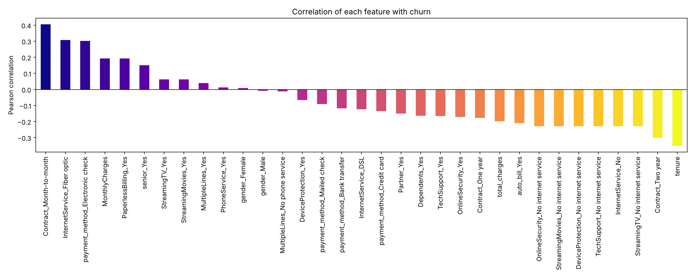

# Telco Customer Churn: Data Cleaning & Analysis


A telecoms provider loses about 1 in 4 customers. This project takes raw customer data, cleans it, and turns it into analysis-ready datasets that explain who churns and why.

**My role: data analyst, responsible for data cleaning and correlation analysis.** I built the cleaning pipeline, created the analysis datasets and ran the correlation study that identified the main churn drivers.

*Completed as part of a team project for the MSc Business Analytics, University of Bristol (October 2024).*

## Results at a glance

| | |
|---|---|
| Customers | 7,043 |
| Churn rate | 26.5% |
| Strongest churn driver | Month-to-month contract (correlation +0.41) |
| Strongest retention signal | Tenure (−0.35) and two-year contracts (−0.30) |



**What drives churn**
- **Contract type matters most.** Month-to-month customers churn far more; one- and two-year contracts are strongly linked to staying.
- **Fibre optic customers churn more** (+0.31), likely because of price sensitivity or higher expectations of service.
- **Electronic cheque payers churn more** (+0.30), while customers on automatic payments stay longer.
- **Add-on services help retention.** Customers with tech support or online security churn less.

## What the pipeline does

```
raw CSV (21 columns)
   │
   ├─ fix TotalCharges: 11 blank values (new customers, tenure 0) set to 0, column made numeric
   ├─ add contract_month: contract length in months (1 / 12 / 24)
   ├─ add auto_bill: does the customer pay automatically?
   ├─ standardise labels: "No internet service" / "No phone service" → "No"
   │
   ├─▶ Version 1: clean, readable dataset (33 columns), used for Excel visualisation
   │
   ├─ encode churn as 0/1, drop redundant columns
   ├─ one-hot encode categoricals (binary → single flag; multi-class → every level kept)
   │
   └─▶ Version 2: fully numeric dataset (34 columns), used for correlation analysis
```

These datasets were then used for Excel dashboards and for a churn prediction model (83% accuracy), both covered in the [project report](docs/telco_churn_report.pdf).

## Data quality checks

`tests/test_pipeline.py` checks every run:
- no rows are lost between stages
- customer IDs are unique
- `total_charges` has no gaps, and the 11 filled values are all tenure-0 customers
- every one-hot group adds up to exactly 1 per customer
- the modelling dataset is fully numeric

These run automatically on every push through GitHub Actions.

## Run it yourself

```bash
git clone https://github.com/ranzith1282000-beep/telco-customer-churn.git
cd telco-customer-churn
pip install -r requirements.txt
python src/pipeline.py      # writes data/processed/ and images/
pytest                      # data quality tests
```

## Repository layout

```
├── data/
│   ├── raw/                 IBM Telco Customer Churn sample dataset
│   └── processed/           Version 1 and Version 2 outputs
├── src/pipeline.py          reproducible pipeline (raw → V1 → V2 → chart)
├── tests/test_pipeline.py   data quality checks
├── notebooks/               original exploratory notebook from the project
├── docs/                    full project report (PDF)
└── images/                  charts
```

`src/pipeline.py` is a tidied, reproducible version of the original notebook. Its outputs match the datasets used in the report exactly.

## Tools

Python, pandas, NumPy, Matplotlib, pytest, GitHub Actions, Excel

## Data

[IBM Telco Customer Churn](https://www.kaggle.com/datasets/blastchar/telco-customer-churn) sample dataset: 7,043 customers, 21 attributes, fictional data published by IBM for learning purposes.
